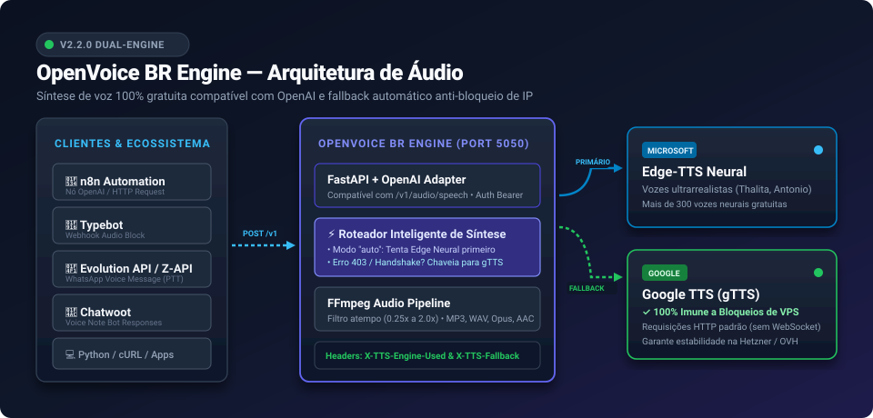

# OpenVoice BR Engine 🇧🇷 🎙️

<p align="center">
  <b>Serviço Local de Síntese de Voz (TTS) 100% Gratuito e Compatível com a API da OpenAI.</b><br/>
  <i>Motor Dual: Microsoft Edge-TTS Neural + Google Translate TTS com Fallback Automático Anti-Bloqueio.</i><br/>
  <b>Free & Local OpenAI-Compatible Text-to-Speech Engine with Neural & HTTP Dual Fallback.</b>
</p>

<p align="center">
  
  
  
</p>

<p align="center">
  <!-- Tags de Compatibilidade de Ecossistema -->
  
  
  
  
  
  
  
  
</p>

<p align="center">
  <b><a href="#-português">🇧🇷 Português</a></b> · 
  <b><a href="#-english">🇺🇸 English</a></b> · 
  <b><a href="#-amostras-de-áudio--audio-samples">🎧 Ouvir Áudios</a></b> · 
  <b><a href="#-compatibilidade-com-bots-e-automações">🤖 Bots &amp; Automações</a></b> · 
  <b><a href="portainer-stack.yml">🚢 Stack Portainer</a></b> · 
  <b><a href="VOICES.md">🎙️ Catálogo de Vozes</a></b>
</p>

> 🚀 **Última Atualização:** **04 de Novembro de 2026 — Versão 2.2.0**  
> *Resolução definitiva de erro 403 / IP blacklist em VPS (Hetzner, OVH, etc.), Arquitetura Dual-Engine com Google TTS, Stack Portainer integrada à `network_public` e documentação para n8n, Typebot, Chatwoot e Evolution API.*

---

## 🗺️ Arquitetura do Sistema

<p align="center">
  
</p>

---

## 📚 Índice de Documentação

| Documento | Descrição |
| --- | --- |
| 🚀 **[BEGINNERS_GUIDE.md](BEGINNERS_GUIDE.md)** | **Guia do Iniciante:** Como rodar em 2 minutos sem complicação. |
| 🤖 **[INTEGRATIONS.md](INTEGRATIONS.md)** | **Integrações de Bots:** Tutoriais para n8n, Typebot, Chatwoot e Evolution API. |
| 🚢 **[DEPLOY.md](DEPLOY.md)** | **Guia de Deploy:** Portainer, VPS Hetzner, Docker Compose, Cloudflare Tunnel e CI/CD. |
| 🎙️ **[VOICES.md](VOICES.md)** | **Catálogo de Vozes:** Tabela de vozes neurais brasileiras e mais de 300 vozes globais. |
| 📖 **[API_USAGE_GUIDE.md](API_USAGE_GUIDE.md)** | **Guia Técnico da API:** Todos os parâmetros, endpoints e exemplos cURL/PowerShell. |
| 📝 **[CHANGELOG.md](CHANGELOG.md)** | **Histórico de Versões:** Lista detalhada de novidades de cada versão. |

---

# 🇧🇷 Português

O **OpenVoice BR Engine** transforma texto em áudio de alta fidelidade (**MP3, WAV, Opus, AAC, FLAC**) rodando diretamente na sua infraestrutura local ou servidor VPS. Ele expõe a mesma interface HTTP da OpenAI (`POST /v1/audio/speech`), permitindo que você o conecte diretamente ao **n8n**, **Typebot**, **Chatwoot**, **Evolution API**, chatbots e agentes de IA — **100% gratuito, sem limites de tokens e sem cartão de crédito**.

### 🌟 Destaques da Versão 2.2.0:
- **Motor Dual com Fallback Automático Anti-Bloqueio:** Combina a voz neural do **Microsoft Edge-TTS** com a estabilidade contínua do **Google Translate TTS (gTTS)**.
- **Solução Definitiva para VPS Hetzner / Data Centers:** Quando a Microsoft bloqueia requisições WebSocket vindas de IPs de VPS (erro HTTP 403 / WSServerHandshakeError), o sistema **aciona o fallback transparente para o Google TTS via HTTP padrão**, entregando o áudio com status `200 OK`. **Seu fluxo no n8n nunca quebra!**
- **Modo 100% HTTP:** Configure `TTS_ENGINE=gtts` para operar exclusivamente via requisições HTTP normais de altíssima velocidade.
- **Ajuste Fino de Velocidade com FFmpeg:** Velocidades fracionadas de `0.25x` a `2.0x` através do filtro `atempo`.
- **Cabeçalhos de Diagnóstico:** Cada resposta inclui `X-TTS-Engine-Used` (`edge-tts` ou `gtts`) e `X-TTS-Fallback` (`true`/`false`).
- **Stack Oficial do Portainer Integrada:** Configuração pronta com rede externa (`network_public`), limites de memória (512M) e `tmpfs` em RAM para geração ultra-rápida sem desgastar o disco da VPS.

---

## 🎧 Amostras de Áudio / Audio Samples

Você pode conferir a qualidade das vozes geradas pelos dois motores:

| Motor | Voz Utilizada | Descrição | Arquivo para Download / Reprodução |
| --- | --- | --- | --- |
| **Microsoft Edge-TTS** | `pt-BR-ThalitaMultilingualNeural` | Voz neural ultra-realista, expressiva e humana | 🔊 **[Ouvir Áudio Neural (MP3)](examples/audio_samples/exemplo_edge_neural_ptbr.mp3)** |
| **Google Translate TTS** | `pt-br` (HTTP Fallback) | Síntese padrão Google, imune a bloqueios em VPS | 🔊 **[Ouvir Áudio Google (MP3)](examples/audio_samples/exemplo_google_gtts_ptbr.mp3)** |

---

## 🚢 Como Subir no Portainer (Recomendado para VPS)

1. Acesse o **Portainer** da sua VPS.
2. Vá em **Stacks** → **Add stack**.
3. Defina o nome como `multivozes`.
4. Cole o conteúdo de **[portainer-stack.yml](portainer-stack.yml)** no Web editor.
5. Clique em **Deploy the stack**.

> 💡 A imagem multi-arquitetura (`amd64` e `arm64`) será baixada diretamente do GitHub Container Registry (`ghcr.io/leaomoacir/multivozes_br_engine:latest`).

---

## ⚡ Início Rápido com Docker

### Opção A: Em 1 Linha de Comando (Docker Run)
```bash
docker run -d \
  --name multivozes \
  --restart unless-stopped \
  -p 5050:5050 \
  -e TTS_ENGINE=auto \
  -e REQUIRE_API_KEY=false \
  ghcr.io/leaomoacir/multivozes_br_engine:latest
```

### Opção B: Docker Compose
```bash
git clone https://github.com/leaomoacir/multivozes_br_engine.git
cd multivozes_br_engine
cp .env.example .env
docker compose up -d
```

---

## 🤖 Compatibilidade com Bots e Automações

O OpenVoice BR Engine se conecta de forma nativa a todo o ecossistema brasileiro de automações:

### 🔴 n8n (Nó HTTP Request ou Nó OpenAI)
```json
POST http://multivozes:5050/v1/audio/speech
Content-Type: application/json

{
  "model": "tts-1",
  "input": "Olá! Seu fluxo do n8n agora gera áudios de alta qualidade gratuitamente.",
  "voice": "alloy",
  "response_format": "mp3",
  "speed": 1.0,
  "engine": "auto"
}
```
*Selecione a opção **File** no formato de resposta do nó HTTP Request do n8n para receber o binário do áudio.*

### 📱 Evolution API (Mensagem de Voz PTT no WhatsApp)
Converta a saída binária do n8n em Base64 e envie para o endpoint `/message/sendWhatsAppAudio` da Evolution API. A mensagem será entregue no WhatsApp como **nota de voz gravada na hora** (com o ícone do microfone azul).

### 🤖 Typebot
Adicione um bloco de **Webhook** no seu Typebot fazendo um `POST` para `http://SEU_IP:5050/v1/audio/speech` e exiba o áudio gerado diretamente na conversa com o lead.

### 💬 Chatwoot
Anexe o arquivo binário retornado diretamente nas conversas dos seus clientes via API do Chatwoot (`/messages` com anexo de áudio).

👉 Para códigos, scripts e payloads detalhados de cada plataforma, veja **[INTEGRATIONS.md](INTEGRATIONS.md)**.

---

## ⚙️ Modos do Motor (`TTS_ENGINE`)

Você pode escolher o comportamento do motor no arquivo `.env` ou em cada requisição individual no campo `"engine"`:

| Modo | Comportamento | Quando Usar |
| --- | --- | --- |
| `"auto"` *(Padrão)* | Tenta o **Edge-TTS neural**. Em caso de bloqueio de IP (403), timeout ou handshake na Microsoft, **aciona o Google TTS imediatamente**. | Recomendado para garantir alta qualidade sem nunca quebrar o fluxo. |
| `"gtts"` | Realiza a síntese 100% via **Google Translate TTS** por HTTP padrão. | Ideal para servidores VPS de data center (Hetzner, OVH, etc.) com IPs bloqueados na Microsoft. |
| `"edge"` | Usa exclusivamente o **Edge-TTS neural**. | Quando você deseja apenas voz neural e prefere descartar a síntese caso a Microsoft bloqueie. |

---

## 🎙️ Principais Vozes Brasileiras

| Alias Rápido | Nome Técnico (Edge) | Gênero | Estilo |
| --- | --- | --- | --- |
| `alloy` ou `thalita` | `pt-BR-ThalitaMultilingualNeural` | Feminino | Expressiva, humana e fluida (**Padrão**) |
| `antonio` | `pt-BR-AntonioNeural` | Masculino | Sério, natural, ideal para notícias e narrações |
| `francisca` | `pt-BR-FranciscaNeural` | Feminino | Calorosa, acolhedora, perfeita para suporte |
| `fabio` | `pt-BR-FabioNeural` | Masculino | Jovem e conversacional |

👉 Veja a lista completa de mais de 300 vozes em **[VOICES.md](VOICES.md)**.

---

<br/>

---

# 🇺🇸 English

**OpenVoice BR Engine** is an open-source, **100% free**, self-hosted Text-to-Speech (TTS) engine that is fully compatible with OpenAI's speech API (`POST /v1/audio/speech`). It allows you to generate lifelike audio in multiple formats (**MP3, WAV, Opus, AAC, FLAC**) without needing an OpenAI account, API keys, or credit cards.

> 🚀 **Last Updated:** **November 4, 2026 — Version 2.2.0**  
> *Permanent fix for Microsoft WebSocket 403 blocks on VPS hosts (Hetzner, OVH, etc.), Dual-Engine architecture with Google Translate TTS fallback, official Portainer stack on `network_public`, and guides for n8n, Typebot, Chatwoot, and Evolution API.*

---

## 🚀 Key Features

- **Dual-Engine Architecture with Automatic Fallback:** Combines realistic neural voices from **Microsoft Edge-TTS** with standard HTTP synthesis from **Google Translate TTS (gTTS)**.
- **Datacenter Anti-Block Protection:** Solves the notorious HTTP 403 / `WSServerHandshakeError` caused by Microsoft blacklisting datacenter IP ranges (Hetzner, OVH, AWS, etc.). The engine automatically falls back to Google TTS via standard HTTP, guaranteeing a `200 OK` response.
- **100% OpenAI API Compatibility:** Drop-in replacement for `/v1/audio/speech`. Connects directly to **n8n**, **Typebot**, **Chatwoot**, **Evolution API**, **Flowise**, and **Dify**.
- **Accurate FFmpeg Processing:** Fractions of speed between `0.25x` and `2.0x` via FFmpeg `atempo` filter.
- **Portainer Stack & Docker CI/CD:** Ready-to-paste stack ([portainer-stack.yml](portainer-stack.yml)) and automated multi-arch GitHub Actions publishing (`linux/amd64` and `linux/arm64`).

---

## ⚡ Quick Start (Docker)

```bash
docker run -d \
  --name multivozes \
  --restart unless-stopped \
  -p 5050:5050 \
  -e TTS_ENGINE=auto \
  -e REQUIRE_API_KEY=false \
  ghcr.io/leaomoacir/multivozes_br_engine:latest
```

Test with cURL:
```bash
curl -X POST http://localhost:5050/v1/audio/speech \
  -H "Content-Type: application/json" \
  -d '{"model":"tts-1","input":"Hello! OpenVoice BR Engine is running successfully.","voice":"alloy"}' \
  --output speech.mp3
```

---

## 💡 Practical Examples

Explore code samples in the [examples/](examples/) directory:
- [examples/curl_examples.sh](examples/curl_examples.sh) — Bash/cURL scripts.
- [examples/powershell_examples.ps1](examples/powershell_examples.ps1) — PowerShell scripts for Windows.
- [examples/python_example.py](examples/python_example.py) — Python script with `requests`.
- [examples/n8n_workflow_template.json](examples/n8n_workflow_template.json) — Importable n8n workflow.
- [examples/audio_samples/](examples/audio_samples/) — Real pre-generated MP3 samples.

---

## 👥 Créditos e Agradecimentos / Credits & Acknowledgements

Este projeto é mantido com carinho para a comunidade open-source.

Agradecimentos especiais aos criadores e projetos que serviram de inspiração:
- **Samuel de Sousa Santos (samucatutoriais)** — Criador do projeto MultiVozes BR original.
- **[travisvn/openai-edge-tts](https://github.com/travisvn/openai-edge-tts)** — Projeto pioneiro para a camada de compatibilidade com a OpenAI.
- **[rany2/edge-tts](https://github.com/rany2/edge-tts)** — Biblioteca Python para comunicação com o Edge TTS.
- **[Belledonne Communications / gTTS](https://github.com/BelledonneCommunications/gTTS)** — Biblioteca para síntese via Google Translate TTS.
- **Comunidade n8n Brasil & Automação Open-Source**.

---

## 📄 Licença / License

Distribuído sob a licença [MIT](LICENSE). Consulte o arquivo `LICENSE` para mais detalhes.
